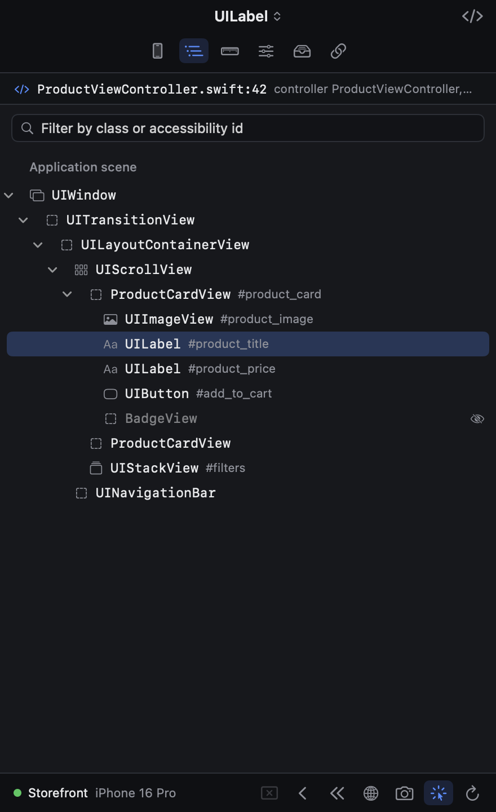
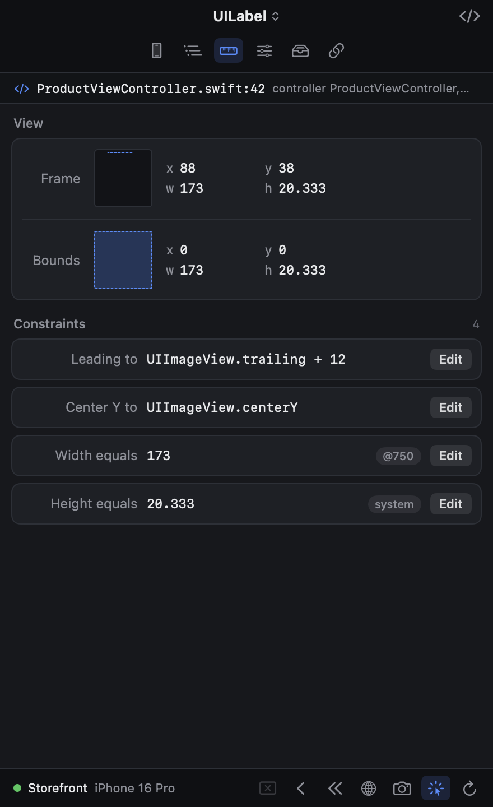

# Voly

A live UI inspector for the iOS Simulator and the Android Emulator. Voly is a macOS menu-bar app that docks next to the Simulator and lets you inspect and edit the app that is running in it — without adding anything to the app, and without disturbing your Xcode debug session. Debug builds running in an Android emulator are inspected the same way, in the same window ([Android](#android-emulators)).

| View tree | Layout |
| --- | --- |
|  |  |

- Inspect the full view hierarchy and pick views by clicking them in the simulator
- Edit `UIView` / `CALayer` properties and Auto Layout constraints live
- Measure the distance between two views
- Jump to the exact source file and line in Xcode
- Switch the app's language live, with independent layout direction
- Capture the simulator screen, the app's content, or a single view
- Dismiss / pop / pop to root from the inspector
- Inspect and edit `UserDefaults`, and fire deep links
- Let an AI coding agent see all of the above through a built-in [MCP server](#ai-agents-mcp)
- The same for Android apps: views, layout params, SharedPreferences, languages, Jetpack Compose semantics

## Install

1. Download `Voly-<version>.dmg` from [Releases](https://github.com/latifatcii/Voly/releases).
2. Open it and drag **Voly** into **Applications**.
3. Open Voly. The build is not notarized, so macOS blocks the first launch: right-click the app and choose **Open**, or allow it under **System Settings → Privacy & Security**. From a terminal you can clear the flag instead:

   ```sh
   xattr -dr com.apple.quarantine /Applications/Voly.app
   ```

Requirements: macOS 14 or later, and Xcode with at least one iOS Simulator runtime. Runtime integration is verified on Xcode 26.2 with the iOS 18.3 and 26.2 simulator runtimes; on a runtime it can't work with, Voly says so instead of guessing.

For Android: `adb` (the Android SDK's platform-tools, as installed by Android Studio) and an emulator running Android 8 (API 26) or later. Nothing else to set up, and nothing changes for you if you don't use Android — see [Android emulators](#android-emulators).

## Using it

1. Launch Voly. It lives in the menu bar. Each booted simulator gets runtime integration within a few seconds.
2. Run your app as usual — Xcode ⌘R, the home screen, or `simctl launch`. It comes up inspectable, with the debugger still attached.
3. Press **⌘E** while the Simulator is frontmost (or **⌃⌥⌘V** from anywhere) to show Voly. It docks next to the simulator window you last focused and opens in pick mode: click a view in any simulator to select it. Press Esc to hand taps back to the app.

Apps that were already running before Voly started are listed as not instrumented; they become inspectable the next time they launch. Voly never restarts an app by itself — the **Relaunch…** button next to such an app does it after asking.

| Shortcut | Action |
| --- | --- |
| ⌘E (Simulator frontmost) | Show / hide Voly |
| ⌃⌥⌘V | Show / hide Voly from anywhere |
| ⌃⌥⌘M | Pick mode on / off |
| ⌃⌥⌘J | Jump to Source for the selected view |
| Esc | Leave pick mode |

Voly asks for Accessibility permission only for live hover measurement while picking. Everything else, including docking and selecting by click, works without it.

### Choosing simulators and apps

Integration applies to every booted simulator by default. Switch a simulator off in the Simulators tab or under menu bar → **Runtime Integration**, or uncheck **All simulators** to pick them by hand. Right-click an app in the list to exclude it, or to instrument only selected apps. Apple's own apps are left alone.

An app launched with `VOLY_DISABLE=1` in its environment is never instrumented.

## Android emulators

Run a **debug build** of your app in an Android emulator — from Android Studio, Gradle or `adb` — and it shows up in Voly's **Simulators** tab under **Android** within a few seconds. Select it, or click one of its views in pick mode, and everything above works on it: the view tree, properties, live edits, measuring, screenshots, language switching, navigation, preferences, deep links, Jump to Source and the MCP tools.

Unlike on iOS, an app that was already running is inspectable too: Voly attaches its agent to the running process, so nothing is relaunched and a debugger stays attached. Android Studio's Layout Inspector uses the same mechanism.

What Android things are called in Voly:

| In Voly | On Android |
| --- | --- |
| Frames in points | dp, from the display's top-left corner |
| Accessibility identifier | the view's `android:id` |
| View controller | the activity or fragment a view belongs to |
| Constraints (Layout tab) | fixed `layout_width` / `layout_height`, margins, and every ConstraintLayout connection — the constant is editable |
| Custom properties | text, text size and color, padding, margins, weight, bias…, and the properties of your own view classes |
| UserDefaults | SharedPreferences (one "suite" per preferences file) |
| Language | the app's per-app language on Android 13+; activities are recreated in it |
| Dismiss / Pop / Pop to Root | close a dialog, bottom sheet or popup / Back / empty the back stack |
| SwiftUI accessibility elements (MCP) | Jetpack Compose semantics: text, role, state, test tag, bounds |
| Jump to Source | your Kotlin or Java class, or the layout XML that declares the view's id, opened in Android Studio |

Measuring works from Voly's tree as on iOS (hover another row). In the emulator itself, with a view selected in pick mode, **drag** from it: the distance to whatever is under the pointer is drawn live.

Switch a device off with its toggle in the Simulators tab; exclude an app from its context menu. Voly finds `adb` in the usual places (`~/Library/Android/sdk`, `ANDROID_HOME`, Homebrew); point it elsewhere with:

```sh
defaults write com.latifatci.Voly voly.android.adbPath /path/to/adb
```

Voly only uses `adb` while an adb server is already running (Android Studio and the emulator start one), so it never starts a daemon on a Mac that isn't used for Android.

To try it, [`SampleAppAndroid`](SampleAppAndroid) is a small app with views, Compose, dialogs, translations and deliberately broken layouts: `cd SampleAppAndroid && ./gradlew :app:installDebug`.

## AI agents (MCP)

Voly is also an MCP server. A coding agent — Claude Code, Cursor, Codex, or anything else that speaks the Model Context Protocol — can read the running app the way you do in the inspector, instead of guessing from a screenshot: every view with its class, exact frame, text, font, colors, constraints, owning view controller and source file. The same tools work on Android apps; the server tells the agent what differs (dp, `android:id`, Compose, SharedPreferences).

Set it up once. Menu bar → **AI Agents** copies the command for your agent with the right path filled in; for an app in `/Applications` it is:

```sh
claude mcp add --scope user voly -- /Applications/Voly.app/Contents/MacOS/Voly --mcp
```

```sh
codex mcp add voly -- /Applications/Voly.app/Contents/MacOS/Voly --mcp
```

For other clients, **Copy Configuration for Other Agents** gives the usual `mcpServers` entry (`"command": "/Applications/Voly.app/Contents/MacOS/Voly", "args": ["--mcp"]`).

Then just ask — “the subtitle on this screen is cut off, find out why and fix it”, “make this screen match the design”, “which view controller draws this banner?”. What the agent reads looks like this:

```
SampleApp (com.example.SampleApp) in iPhone 16 Pro
Screen 393×852 pt @3x, portrait, light mode, text size L. Top view controller: LocalizationDemoVC.

UINavigationTransitionView #9 › UIViewControllerWrapperView #10 › UIView #11 0,0 393×852 bg=#FFFFFF vc=LocalizationDemoVC
  UIStackView #12 16,117.7 361×338.3 stack(vertical spacing=14 alignment=leading distribution=fill)
    UILabel #13 16,117.7 158.7×26.3 "Welcome to Voly" font=System Regular 22 color=#000000 id=loc.greeting
    UILabel #14 16,158 278.7×20.3 "Switch languages from the…" font=System Regular 17 color=#3C3C43@60% ⚠ text truncated
    UIButton #20 16,388.3 122.3×34.3 "Show Details" font=System Regular 17 color=#FFFFFF bg=#007AFF radius=6
    _UIHostingView<Row> #21 16,436.7 131.3×19.3
      ~ "Hello from SwiftUI" staticText 16,436.7 131.3×19.3
```

| Tool | What it does |
| --- | --- |
| `get_screen` | The whole view tree as text, as above, with ⚠ on truncated text, ambiguous layout, zero-size and off-screen views |
| `get_view` | One view in full: layout inputs (intrinsic size, hugging, compression resistance), its constraints as phrases, all properties, subviews, source file and line |
| `find_views` | Search by text, class, accessibility identifier, or the point a view is at |
| `get_selection` / `select_view` | Read the view you picked in Voly; highlight a view for you in the simulator |
| `screenshot` | The app, one view, or the whole simulator display — with the points-to-pixels factor |
| `list_apps`, `get_app_state`, `get_user_defaults` | Simulators and apps, navigation stack, languages, defaults |
| `set_property`, `set_constraint` | Try a fix in the running app before touching source |
| `navigate`, `set_language`, `open_url`, `set_user_default`, `relaunch_app` | Move the app into the state to look at |

Good to know:

- **Local only.** The agent starts `Voly --mcp`, which talks to the running Voly over a socket in `~/Library/Developer/Voly/` that only your user can open. Nothing listens on the network.
- **You decide how much.** Menu bar → **AI Agents** has one switch for inspecting and one for changing the app. With the second off, agents can look but not touch. A small **Agent** mark in Voly's footer shows when one is at work.
- **Voly starts when it is needed.** Having the server configured doesn't launch anything; the first tool call starts Voly if it isn't running. Apps launched after that are inspectable.
- **After updating Voly, relaunch apps that were already running.** A running app keeps the agent it was launched with. `list_apps` marks such apps, and they need one more launch (Run from Xcode is enough) before their screen can be read.
- **Changes are live, not saved.** `set_property` and `set_constraint` change the running app only — the agent still has to make the real change in your source.
- **An agent sees what you can see in Voly**, including the app's `UserDefaults`. Text typed into secure text fields is withheld.
- **SwiftUI** content is reported through its accessibility elements: text, role and frame, but not font or color. To read it, Voly switches on application accessibility in that simulator the first time an agent asks — the same switch Xcode's Accessibility Inspector uses.
- **Jetpack Compose** content is reported through its semantics tree in the same way, without changing any setting.

## How it works

```
Voly.app ──simctl spawn <udid> launchctl debug … ─▶ simulator's runningboardd
                                                     └─ VolyLaunchBridge.dylib
Xcode / SpringBoard / simctl ── launch request ─────▶ bridge appends VolyAgent.dylib
                                                       to DYLD_INSERT_LIBRARIES
app starts with the agent ◀── loopback WebSocket + token ──▶ Voly.app
```

- A small bridge is loaded into the simulator's `runningboardd`, the process every app launch passes through. For eligible apps it appends Voly's agent to the launch's `DYLD_INSERT_LIBRARIES`, keeping whatever was already there — including the libraries Xcode inserts for debugging.
- The agent listens on `127.0.0.1` only and requires a per-process token before accepting any command.
- Jump to Source resolves addresses through LLDB's line tables on the binary on disk. It never attaches to your app.

On Android there is nothing to hook: an agent can be attached to a process that is already running.

```
Voly.app ── adb push / run-as ──▶ agent files in the app's own code cache
         ── adb shell cmd activity attach-agent <pid> ──▶ ART loads the agent into the running app
app with the agent ◀── WebSocket + token, over adb forward to a Unix socket ──▶ Voly.app
```

- The agent is Java plus a small JVMTI library that loads it ([`AndroidAgent`](AndroidAgent)). It speaks the same protocol as the iOS agent, so the inspector and the MCP tools don't care which one answers.
- It listens on an abstract Unix socket that only `adb forward` is pointed at, and like the iOS agent refuses every command until a handshake carries the token Voly chose for that attach.
- It adds nothing to the app's view hierarchy: the highlight is drawn through `ViewOverlay`, and pick mode wraps each window's callback only while it is on.

What Voly changes, and how it is undone:

| Change | Removed by |
| --- | --- |
| A one-shot `launchctl debug` environment for the simulator's `runningboardd` | automatically; it is consumed by the restart Voly triggers |
| The bridge loaded in that `runningboardd` | switching the simulator off, quitting Voly, or shutting the simulator down |
| `~/Library/Developer/Voly/` (config, status, copies of the two dylibs) | switching integration off; pruned as simulators shut down |
| `~/Library/Developer/Voly/mcp.sock`, the socket AI agents reach Voly through | quitting Voly |
| Application accessibility switched on in a simulator, the first time an AI agent reads a screen there | erasing the simulator; it is the simulator's own setting and harmless to leave on |
| Android: the agent loaded into a running debug app, with the hidden-API filter lifted for that process | the app's next launch; it is in memory only |
| Android: `code_cache/voly-<version>/` in the app's data, `/data/local/tmp/voly-<version>/` on the device (≈150 KB) | clearing the app's cache / `adb shell rm -r /data/local/tmp/voly-*` |
| Android: one forwarded port per inspected app (`adb forward --list`) | automatically, when the app exits or Voly quits |
| Android 13+: the app's per-app language, when you switch language through Voly | choosing System / Default again |

Nothing is written into the simulator runtime, Xcode, or macOS settings, and physical devices are never touched. Restarting the simulator's `runningboardd` does not terminate running apps.

## Limitations

- **Simulators only.** The SDK (below) can run on a device and advertise itself on the local network, but that path is not exercised.
- **UIKit.** SwiftUI views appear as the UIKit views that host them. AI agents additionally get SwiftUI's accessibility elements (text, role, frame), not its fonts or colors.
- **Language refresh is exact, not exhaustive.** Text already on screen is rewritten only when it is exactly a value from one of the app's `.strings` tables. Formatted strings, plurals, hard-coded text and SwiftUI `Text` keep their old language until their screen is rebuilt. Editable text is never touched.
- **Source lookup needs debug info** (a Debug build, or a dSYM LLDB can find). Without it you get a file-name match.
- **Private API.** The bridge relies on a private RunningBoard method. It checks for it on every load and refuses to hook otherwise, but a future iOS runtime can remove it.
- **One Voly at a time.** A second copy would manage the same simulators, so it says so and quits.

Android:

- **Debug builds only.** Attaching needs a debuggable app (`run-as` and `attach-agent` refuse anything else). Release builds are listed as not inspectable.
- **Android 8 (API 26) or later.**
- **Emulators are what is tested.** A physical device that adb can reach goes through the same path and is listed, but that path is not exercised.
- **Jetpack Compose** appears as the view that hosts it; its content is only in the MCP tools (as semantics nodes), not in the inspector's tree, and has no font or color — the same as SwiftUI.
- **Layout params are not Auto Layout.** What the Layout tab shows as constraints are sizes, margins and ConstraintLayout connections; their constant can be changed, priority and "active" cannot.
- **Measuring by hovering in the emulator** isn't available (Voly would need to know where the screen sits inside the emulator's window); drag from the selection instead, or hover rows in Voly's tree.
- **No resizable preview**, and DataStore isn't read — SharedPreferences only.
- **The emulator inside Android Studio** (Running Devices) has no window of its own to dock next to; Voly opens where it was. Everything else works.
- **Jump to Source searches by name.** An APK carries no source paths, so classes are found with Spotlight by file name and `package`, and layouts by the view's id. A class in a file named differently isn't found.

## Linking the SDK (optional)

Simulator apps don't need this. Link `VolyAgent` when you want to register custom properties, or to run the agent from inside your own build instead of having it loaded for you.

1. Add this repository as a Swift package and link the `VolyAgent` library into your app target.
2. At scene setup, wrap your root view controller:

   ```swift
   import VolyAgent

   func scene(_ scene: UIScene, willConnectTo session: UISceneSession, options: UIScene.ConnectionOptions) {
       VolyAgent.start()
       guard let windowScene = scene as? UIWindowScene else { return }
       let window = UIWindow(windowScene: windowScene)
       window.rootViewController = VolyAgent.wrap(original: YourRootVC())
       self.window = window
       window.makeKeyAndVisible()
   }
   ```

3. Add `NSBonjourServices = ["_voly-agent._tcp"]` and an `NSLocalNetworkUsageDescription` to your Info.plist.
4. Launch with `VOLY_AGENT_ENABLED=1` in the environment.

The SDK is inert unless the app is a Debug build, `VOLY_AGENT_ENABLED=1` (or `--voly-agent-enabled`) is set, and your code calls `VolyAgent.start()`. In Release builds it is a no-op. SDK agents advertise over Bonjour on the local network and are not token-protected.

Custom properties the Objective-C runtime can't see can be registered:

```swift
VolyAgent.register(BadgeView.self, property: "badgeText", type: .string,
    get: { .string($0.badgeText) },
    set: { view, value in
        if case .string(let s) = value { view.badgeText = s }
    })
```

## Building from source

```sh
# The macOS app; also builds and embeds the two simulator dylibs
xcodebuild -project Voly.xcodeproj -scheme Voly -destination 'platform=macOS' build

# Unit tests (host logic, protocol, MCP server and tools, localization support)
(cd Packages/VolyCore && swift test)

# End-to-end check against a booted simulator
scripts/integration-test.sh <booted-simulator-udid>

# End-to-end check of the MCP server: a scripted MCP client against a real
# Voly.app and the sample app (quit your own Voly first)
scripts/mcp-test.sh <booted-simulator-udid>

# End-to-end check of the Android side against a booted emulator and the
# Android sample app
scripts/android-integration-test.sh [<adb-serial>]

# Rebuild the Android agent after changing AndroidAgent/src
# (needs the Android SDK and NDK; the result is checked in)
AndroidAgent/build.sh

# A distributable DMG in build/dist
scripts/package-release.sh
```

```
Voly/                  macOS app (SwiftUI + AppKit)
Packages/VolyCore/     Swift package
  Sources/VolyAgent/     the in-app agent
  Sources/VolyHost/      simulator integration, discovery, source lookup, MCP server
    Android/               adb, emulator discovery, attaching the Android agent
  Sources/VolyProtocol/  commands, responses, framing
  Sources/VolyModels/    shared model types
  Sources/volyctl/       command-line client over the same host code
LoaderShim/            starts the agent when it is loaded as a dylib
LaunchBridge/          the dylib loaded into the simulator's runningboardd
SampleApp/             a UIKit app to try Voly against
AndroidAgent/          the Android agent (Java) and the library that loads it
Voly/AndroidAgentPayload/  the built Android agent, bundled into Voly.app
SampleAppAndroid/      an Android app to try Voly against
scripts/               end-to-end tests and release packaging
```

`volyctl` drives the same code as the app from a terminal; see the header of `Packages/VolyCore/Sources/volyctl/main.swift` (and `AndroidCommands.swift` for `volyctl android …`). A Debug build can also render every inspector tab from fixture data to PNG files, without a simulator: `VOLY_UI_PREVIEW=/tmp/voly-ui Voly.app/Contents/MacOS/Voly`.
